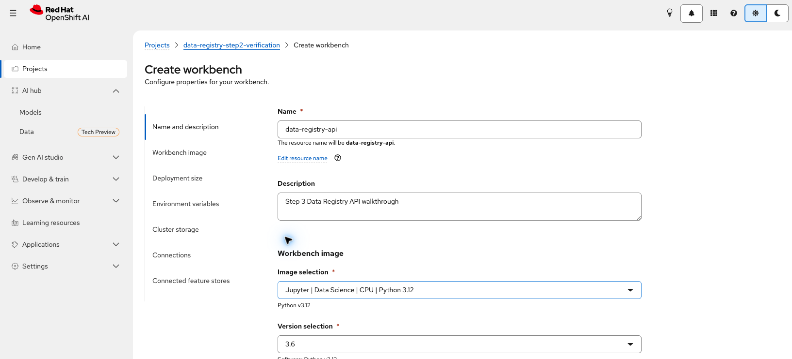
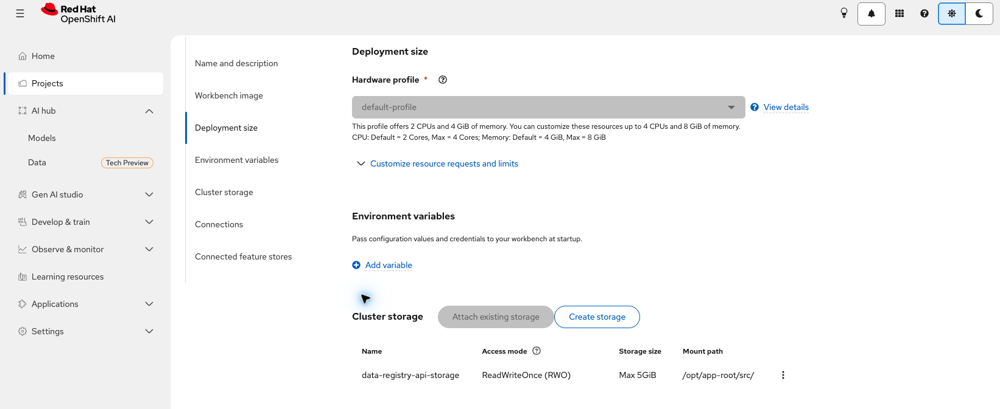
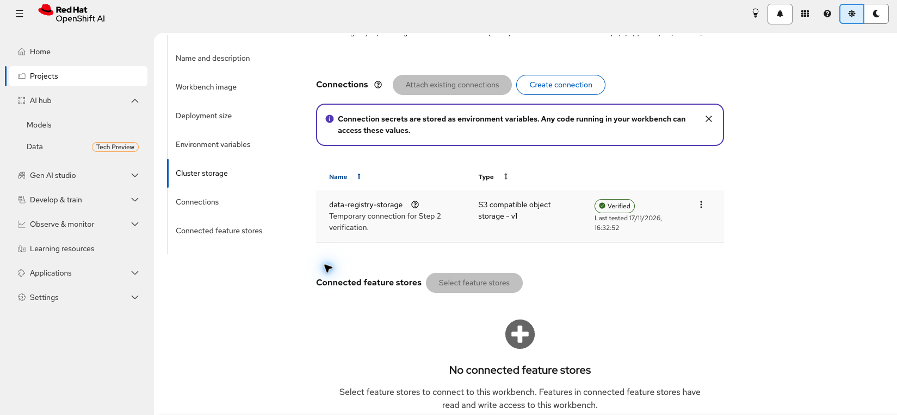
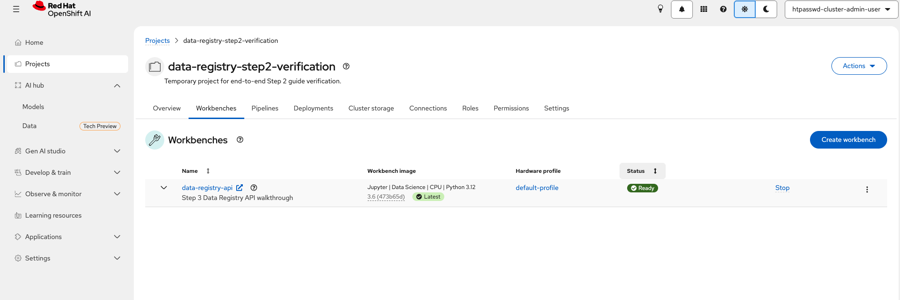
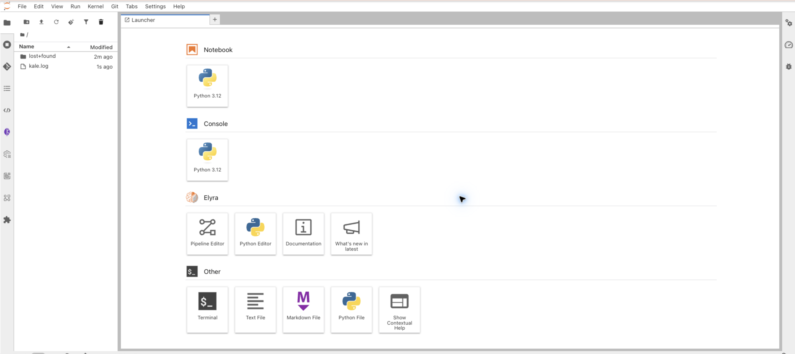

# Step 3: Use the Data Registry API

[← Step 2: Register an asset](../02-register-data-asset/README.md) ·
[Step 4: Share access →](../04-share-registry-access/README.md) ·
[Guide index](../README.md)

Use a Jupyter workbench to read the metadata registered in Step 2, download
the synthetic FAQ through its attached S3 connection, and register a second
catalog entry through the API. The registry stores metadata and a connection
reference; the S3 request separately verifies access to the document bytes.
The connection's dashboard **Verify** status does not substitute for the
workbench's list and download checks.

This step uses the project **Workbenches** page available on the RHOAI 3.6
cluster used for verification. Other installations can offer different
workbench controls or hardware profiles. The notebook keeps the project,
collection, asset, service URL, S3 prefix, and expected checksum together in
one configuration cell. It never prints a user token or S3 credential.

## 1. Check prerequisites

Complete [Step 2](../02-register-data-asset/README.md). In
`data-registry-example`, confirm that the `customer-support` collection,
`customer-support-faq` asset, and `data-registry-storage` connection exist.
The object `examples/customer-support/customer-support-faq.md` must already be
in the bucket named by the asset and connection. Use your Step 2 project name
in the notebook if you created these resources in another project.

You need a user token authorized to read and create Data Registry catalog
entries in that project. Leave `USER_TOKEN` empty and enter your token at the
notebook's hidden prompt. The workbench's ServiceAccount is not used to
authenticate the registry requests. Do not paste a token into a notebook
cell: JupyterLab can autosave it to disk.

Your user needs project access to create or open the workbench, attach the
connection, and read and create Data Registry entries. On this cluster, the
OpenShift `admin` role bound in the Step 2 project includes the required
registry operations and `connections use`. The attached S3 credentials must
also allow listing and reading the fixture object. A narrower registry role
can be used if it grants the same API operations and `connections use` in the
project; [Step 4](../04-share-registry-access/README.md) covers role
assignments.

> **Verification scope:** The first run used a **cluster-admin user's token**.
> For the decisive permissions check, non-cluster-admin `endUser1` was bound to
> project `admin` in the Step 2 scratch project. That user created a new
> workbench in the dashboard, attached the existing connection, and uploaded
> the notebook. With only `PROJECT` changed to the scratch namespace, all ten
> code cells passed in that new workbench using the user's token, including
> API reads, the S3 checksum, and safe reuse of existing API entries. A
> separate run in the original workbench created fresh metadata with the same
> user's token and verified every field on read-back. The token was passed
> privately to a separate kernel for the full runs; the notebook's masked
> interactive prompt was checked separately with non-secret input. Registry
> requests did not use the workbench ServiceAccount. Project `admin` plus
> ordinary authenticated access was sufficient on the verified cluster;
> permissions may differ on another installation.

## 2. Create the workbench and attach the connection

In the RHOAI dashboard, open **Projects**, select your Step 2 project, open
**Workbenches**, and select **Create workbench**. Enter these settings:

| Setting | Selection |
| --- | --- |
| Name | `data-registry-api` |
| Workbench image | **Jupyter \| Data Science \| CPU \| Python 3.12**, version **3.6** |
| Hardware profile | An available CPU profile; the verified cluster's `default-profile` provides 2 CPUs and 4 GiB |
| Home storage | 5 GiB at the default `/opt/app-root/src/` path |
| Connections | **Attach existing connections** → `data-registry-storage` |

The form initially offered 20 GiB home storage on the verified cluster. Use
the storage row's **Edit** action to set it to 5 GiB before creation. Select
the connection by name in **Connections**; there is no credential entry or
Secret mount path to configure. Leave **Connected feature stores** empty for
this example. Create the workbench, wait for **Ready**, and open JupyterLab.

The verified workbench received its normal pod labels, the public OpenShift
service CA, and the attached connection's settings automatically. Its notebook
reached the registry Service without a manual pod-label change. You do not
need to patch a pod label, create a ServiceAccount RoleBinding, or upload a CA
file for this user-token flow on the verified cluster. The notebook checks
these runtime prerequisites and stops with a clear message if they are absent
on another installation.

The screenshots below show the **scratch project used for verification**.
Use your own Step 2 project and its connection when following the guide.

<details>
<summary>See the verified workbench screens</summary>









</details>

## 3. Upload and run the notebook

In JupyterLab, upload
[data-registry-api-walkthrough.ipynb](data-registry-api-walkthrough.ipynb)
to the workbench home folder and open it with the Python 3.12 kernel.
The fresh JupyterLab launcher looks like this before upload:

<details>
<summary>See the JupyterLab launcher</summary>



</details>

If browser upload is unavailable, use the tested CLI fallback below from this
guide's directory in a checkout. Set `PROJECT` to your Step 2 namespace.

<details>
<summary>CLI upload fallback</summary>

```bash
PROJECT=data-registry-example
POD="$(oc get pod -n "$PROJECT" -l notebook-name=data-registry-api \
  -o jsonpath='{.items[0].metadata.name}')"
CONTAINER="$(oc get pod "$POD" -n "$PROJECT" \
  -o jsonpath='{.spec.containers[0].name}')"
oc cp data-registry-api-walkthrough.ipynb \
  "$PROJECT/$POD:/opt/app-root/src/data-registry-api-walkthrough.ipynb" \
  -c "$CONTAINER"
```

</details>

The first code cell runs `%pip install` for `requests` and `boto3` in the
active kernel. It uses the package index configured for that workbench; if
your installation requires an approved mirror, have it configured before
running that cell. The verified image already contained both packages.

Run the notebook cells **in order**:

1. Check the public settings in its configuration cell. For the default
   walkthrough, keep `data-registry-example`, `customer-support`,
   `customer-support-faq`, and `data-registry-storage`. For a separate Step 2
   project, change only `PROJECT` to that project's namespace.
2. Provide your own OpenShift user token when prompted. The token is sent
   only in the HTTPS authorization header to the in-cluster registry Service.
   Do not save a notebook with a pasted token.
3. Continue through the API and S3 verification cells. They stop on a
   missing connection setting, unexpected HTTP status, wrong asset metadata,
   missing object, or checksum mismatch.
4. Confirm the final success summary and
   `downloads/customer-support-faq.md` in JupyterLab.

| Notebook check | Expected result |
| --- | --- |
| Runtime preflight | The public service CA and five S3 connection setting names are present; no values are shown. |
| Authentication | Anonymous `GET /v1/config` returns 401; authenticated project config returns 200. |
| Collections | `GET /v1/{project}/namespaces` includes `customer-support`. |
| Asset list and detail | `customer-support-faq` is a `documents` volume at the Step 2 S3 prefix, with a typed reference to `data-registry-storage`. |
| S3 list and download | The attached connection lists and downloads `examples/customer-support/customer-support-faq.md`. |
| Checksum | The downloaded file's SHA-256 is `e5be400a6740cb71a0ae93606a194f6cfcde5db09460b8c88c6e50afb0e57f78`. |
| API registration | A `customer-support-api` collection and `customer-support-faq-api` volume are created or safely reused, then read back with every supplied field. Send purpose, license, maturity, domain, and PII as top-level POST fields; the GET response returns them under `properties`. |

The API registration creates metadata only; it does not upload or copy an S3
object. A rerun reuses the two API-created entries only when their marker and
metadata match. The notebook does not delete project resources or storage.

## If a check fails

| Symptom | What to check |
| --- | --- |
| No Workbenches page or create action | Ask an administrator to check the Workbenches component and your project access. This cluster does not offer the WorkspacesV2 UI. |
| Missing `AWS_*` setting | Confirm that `data-registry-storage` is attached in the workbench's **Connections** section, then restart it. |
| Registry HTTP 401 with your token | Check that you supplied a current user token and that the notebook sends it to the registry Service. |
| Registry HTTP 403 | Check your user's Data Registry role in this project. Step 4 describes grants for users and groups. |
| TLS certificate error | Check that the workbench projects the public `service-ca.crt` and that the Service hostname matches its certificate. Keep verification enabled. |
| Registry timeout | Check workbench readiness and network access to the registry Service on port 443. The verified workbench reached the Service without a manual pod-label change. |
| Connection or path differs | Compare the asset detail page with Step 2. The notebook intentionally rejects a different resource. |
| S3 HTTP 403 or timeout | Check the connection, bucket permissions, and network path. SeaweedFS uses its S3 API on port 8333; its Admin port is not an S3 endpoint. |
| SHA-256 mismatch | Inspect the current object before replacing the fixture. Reupload only when this test key is yours. |
| API create returns a conflict | The notebook checks the existing resource's marker and fields, then stops if they differ. Choose new example names rather than overwriting another entry. |

Continue to [Step 4](../04-share-registry-access/README.md) for user and
group sharing guidance.
