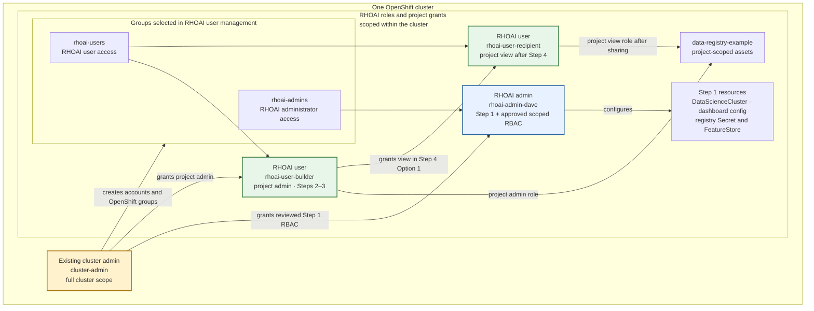

# Optional prerequisite: Create sample users and roles

This guide sets up three separate accounts for the Data Registry walkthrough:
an **RHOAI admin** for Step 1, an **RHOAI user** with project `admin` for
Steps 2–3, and a second **RHOAI user** to receive access in Step 4. The
cluster-admin account used for setup is an existing account, not one of the
three sample users.

Skip this guide if your cluster already has suitable accounts and groups. The
commands below use locally managed OpenShift groups. If your organization
manages users or groups in an identity provider, create the accounts there and
follow the cluster's supported group-synchronization process.

## Example accounts and access

| Account | OpenShift group | Walkthrough access | Used for |
| --- | --- | --- | --- |
| Existing cluster admin | Existing cluster-admin assignment | Full cluster scope | Provision identities, groups, and the minimum required RBAC. |
| `rhoai-admin-dave` | `rhoai-admins` | RHOAI administrator group plus the specific OpenShift RBAC required by Step 1. It is not assigned `cluster-admin`. | Step 1. |
| `rhoai-user-builder` | `rhoai-users` | Project `admin` in `data-registry-example`. | Steps 2–3; grants access in Step 4. |
| `rhoai-user-recipient` | `rhoai-users` | No project access initially. Step 4 grants project `view` for Option 1, or a Data Registry role for Option 2. | Step 4 recipient. |

RHOAI group membership and project permissions are separate. The RHOAI admin
group grants administrator functions in the RHOAI dashboard; it does not make
the member a cluster administrator. Step 1 also edits the `DataScienceCluster`
and dashboard configuration and creates supporting resources. A cluster admin
must grant `rhoai-admin-dave` approved, scoped OpenShift RBAC for those actions.
Do not bind the `rhoai-admins` group to `cluster-admin` for this walkthrough.

The project `admin` role for `rhoai-user-builder` is a namespaced grant. It
provides the minimum project access used by Steps 2–3 and does not grant
cluster-wide administration. The second user receives a project role only
when you perform the sharing step.

## Access and hand-offs



The arrows show this guide's suggested hand-offs. An RHOAI admin may also
complete project steps if they have project `admin`, but the sample separates
the accounts to demonstrate the minimum access for each step. Option 2 in
[Step 4](../04-share-registry-access/README.md) uses a registry-only role; its
project-selector discovery requirement is covered there.

## 1. Create the three login identities

OpenShift authenticates users through the cluster's configured identity
provider. `oc adm groups` creates OpenShift groups; it does not create login
credentials. First check the configured provider:

```bash
oc get oauth cluster -o yaml
```

Create the three accounts in that identity provider. For a development or test
cluster that already uses the **HTPasswd** identity provider, a cluster admin
can add the sample users to its existing file. Find the HTPasswd provider's
secret name under `spec.identityProviders[].htpasswd.fileData.name` in the
OAuth output, then set it below:

```bash
umask 077
HTPASS_SECRET='htpass-secret' # Replace with the secret name from OAuth.

# Retrieve the existing file first so current accounts are retained.
oc get secret "$HTPASS_SECRET" -n openshift-config \
  -o jsonpath='{.data.htpasswd}' | base64 --decode > users.htpasswd
chmod 600 users.htpasswd

# Each command prompts for the password; it is not placed in shell history.
htpasswd -B users.htpasswd rhoai-admin-dave
htpasswd -B users.htpasswd rhoai-user-builder
htpasswd -B users.htpasswd rhoai-user-recipient

# Replace the same HTPasswd secret referenced by OAuth.
oc create secret generic "$HTPASS_SECRET" \
  --from-file=htpasswd=users.htpasswd \
  --dry-run=client -o yaml -n openshift-config | oc replace -f -
```

HTPasswd is intended for development and test clusters. For other identity
providers, provision these accounts through the organization's normal identity
management process. Do not create a new identity provider just for this guide.
See the OpenShift documentation for [updating users in an HTPasswd identity
provider](https://docs.redhat.com/en/documentation/openshift_container_platform/4.20/html/authentication_and_authorization/configuring-identity-providers).

After the identity provider accepts the accounts, log in once as each user so
OpenShift creates or maps the corresponding user identities:

```bash
oc login -u rhoai-admin-dave
oc whoami
```

Repeat with `rhoai-user-builder` and `rhoai-user-recipient`.

## 2. Create the OpenShift groups

Create local OpenShift groups and add the sample accounts:

```bash
oc adm groups new rhoai-admins rhoai-admin-dave
oc adm groups new rhoai-users \
  rhoai-user-builder rhoai-user-recipient

oc get groups rhoai-admins rhoai-users
```

If these groups already exist, add the users instead:

```bash
oc adm groups add-users rhoai-admins rhoai-admin-dave
oc adm groups add-users rhoai-users \
  rhoai-user-builder rhoai-user-recipient
```

If groups come from an external identity provider, use the cluster's supported
group-synchronization process instead of managing their membership with
`oc adm groups`.

In the RHOAI dashboard, open **Settings → User management** and select
`rhoai-admins` as an administrator group and `rhoai-users` as a user group.
This group selection controls RHOAI dashboard access. It does not grant
project roles or the OpenShift permissions needed by Step 1. On clusters that
allow all authenticated users by default, group restriction is optional. See
the RHOAI documentation for [selecting the administrator and user
groups](https://docs.redhat.com/en/documentation/red_hat_openshift_ai_self-managed/3.5/html/managing_openshift_ai/managing-users-and-groups).

## 3. Assign the project roles

Make sure `data-registry-example` exists. A cluster admin can create it for the
walkthrough if needed:

```bash
oc new-project data-registry-example
```

Grant the builder project `admin` so they can create the connection,
collection, and assets in Steps 2–3:

```bash
oc adm policy add-role-to-user admin rhoai-user-builder \
  -n data-registry-example
```

Leave `rhoai-user-recipient` without project access until Step 4. To demonstrate
Option 1 there, sign in as `rhoai-user-builder` and grant the recipient project
`view`:

```bash
oc adm policy add-role-to-user view rhoai-user-recipient \
  -n data-registry-example
```

This gives the recipient project-wide read access, including Data Registry
assets. For Option 2, use the Data Registry role in the
[sharing guide](../04-share-registry-access/README.md) and verify the recipient
can discover the project in the selector before relying on the grant.

## 4. Check Step 1 permissions

RHOAI group membership alone does not authorize the writes in Step 1. Before
using `rhoai-admin-dave`, have a cluster admin confirm that the account can
perform the specific operations required by the installed RHOAI resources:

```bash
oc auth can-i patch datascienceclusters \
  --as=rhoai-admin-dave
oc auth can-i patch odhdashboardconfigs \
  -n redhat-ods-applications --as=rhoai-admin-dave
oc auth can-i create secrets \
  -n rhoai-data-registry --as=rhoai-admin-dave
oc auth can-i create featurestores \
  -n rhoai-data-registry --as=rhoai-admin-dave
```

The installed API names and any additional permissions for PostgreSQL or
storage setup can vary by cluster. This guide checks the main Step 1 actions
instead of shipping a universal ClusterRole; have the cluster admin grant the
required permissions through your organization's reviewed RBAC roles. The
RHOAI admin must not be given `cluster-admin` just to make the RHOAI group
work.

## 5. Use each account in the walkthrough

Use `rhoai-admin-dave` for Step 1, `rhoai-user-builder` for Steps 2–3, and
`rhoai-user-recipient` to verify the sharing result in Step 4. Open a separate
browser session for each account if you need to compare what they can see.
