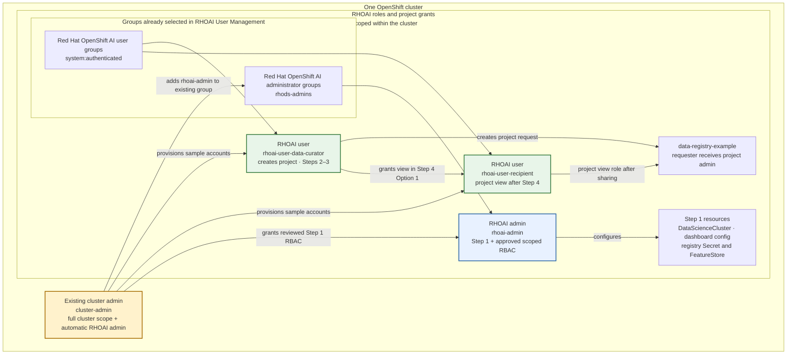

# Optional prerequisite: Create sample users and roles

This guide sets up three separate accounts for the Data Registry walkthrough:
an **RHOAI admin** for Step 1, an **RHOAI user** who creates the project for
Steps 2–3, and a second **RHOAI user** to receive access in Step 4. The
cluster-admin account used for setup is an existing account, not one of the
three sample users.

Prefer existing accounts with the required access; skip this guide if you
already have them. The sample users use the groups shown in RHOAI
**Settings → User management**:
`rhods-admins` for administrators and `system:authenticated` for users. This
guide does not create or replace those groups.

> **Demonstration accounts only:** Create these accounts on an isolated
> development or test cluster, not a shared or production cluster. After the
> walkthrough, revoke the grants made here, remove `rhoai-admin` from
> `rhods-admins` if added here, and delete only accounts created for this guide
> through your identity provider's normal process.

## Example accounts and access

| Account | RHOAI User Management setting | OpenShift group or role | Walkthrough access |
| --- | --- | --- | --- |
| Existing cluster admin | Automatically an RHOAI administrator | `cluster-admin` | Full cluster scope; provisions identities and grants required RBAC. |
| `rhoai-admin` | Red Hat OpenShift AI administrator groups | `rhods-admins` | Step 1; also needs scoped OpenShift RBAC for its resource changes. |
| `rhoai-user-data-curator` | Red Hat OpenShift AI user groups | `system:authenticated` | Creates `data-registry-example` in Step 2 and is its project requester; Steps 2–3 and grants access in Step 4. |
| `rhoai-user-recipient` | Red Hat OpenShift AI user groups | `system:authenticated` | No project role initially. Step 4 grants project `view` for Option 1 or a Data Registry role for Option 2. |

The **Red Hat OpenShift AI administrator groups** setting uses the existing
`rhods-admins` group. Add `rhoai-admin` to that group; cluster admins are
already assigned RHOAI administrator access automatically. The **Red Hat
OpenShift AI user groups** setting uses `system:authenticated`, which includes
all authenticated users, so the two RHOAI users need no group-membership change.

RHOAI group membership and project permissions are separate. Membership in
`rhods-admins` grants RHOAI dashboard administrator functions; it does not make
the member a cluster administrator. Step 1 also edits the `DataScienceCluster`
and dashboard configuration and creates supporting resources. A cluster admin
must grant `rhoai-admin` approved, scoped OpenShift RBAC for those actions.

Create `data-registry-example` in Step 2 while signed in as
`rhoai-user-data-curator`. With the default OpenShift project request template,
the requester receives project `admin`. If your cluster uses a custom project
request template, confirm that it grants the requester project `admin`; if
another account creates the project, the curator needs existing project
`admin`. The second user receives a project role only when you perform the
sharing step.

## Access and hand-offs



The arrows show this guide's suggested hand-offs. An RHOAI admin may also
complete project steps if they have project `admin`, but the sample separates
the accounts to demonstrate the minimum access for each step. Option 2 in
[Step 4](../04-share-registry-access/README.md) uses a registry-only role; its
project-selector discovery requirement is covered there.

## 1. Create the three login identities

OpenShift authenticates users through the cluster's configured identity
provider. `oc adm groups` creates OpenShift groups; it does not create login
credentials. First check the configured provider:

```bash
oc get oauth cluster -o yaml
```

Create the three accounts in that identity provider. For a development or test
cluster that already uses the **HTPasswd** identity provider, a cluster admin
can add the sample users to its existing file. Find the HTPasswd provider's
secret name under `spec.identityProviders[].htpasswd.fileData.name` in the
OAuth output, then set it below. Run these commands from a private temporary
directory outside the repository; `users.htpasswd` contains password hashes
and must not be committed.

```bash
umask 077
HTPASS_SECRET='htpass-secret' # Replace with the secret name from OAuth.

# Retrieve the existing file first so current accounts are retained.
oc get secret "$HTPASS_SECRET" -n openshift-config \
  -o jsonpath='{.data.htpasswd}' | base64 --decode > users.htpasswd
chmod 600 users.htpasswd

# Each command prompts for the password; it is not placed in shell history.
htpasswd -B users.htpasswd rhoai-admin
htpasswd -B users.htpasswd rhoai-user-data-curator
htpasswd -B users.htpasswd rhoai-user-recipient

# Replace the same HTPasswd secret referenced by OAuth.
oc create secret generic "$HTPASS_SECRET" \
  --from-file=htpasswd=users.htpasswd \
  --dry-run=client -o yaml -n openshift-config | oc replace -f -
```

After confirming the Secret update, remove the local `users.htpasswd` file.

HTPasswd is intended for development and test clusters. For other identity
providers, provision these accounts through the organization's normal identity
management process. Do not create a new identity provider just for this guide.
See the OpenShift documentation for [updating users in an HTPasswd identity
provider](https://docs.redhat.com/en/documentation/openshift_container_platform/4.20/html/authentication_and_authorization/configuring-identity-providers).

After the identity provider accepts the accounts, log in once as each user so
OpenShift creates or maps the corresponding user identities:

```bash
oc login -u rhoai-admin
oc whoami
```

Repeat with `rhoai-user-data-curator` and `rhoai-user-recipient`.

## 2. Use the groups already configured for RHOAI

RHOAI User Management uses the existing `rhods-admins` group for **Red Hat
OpenShift AI administrator groups** and the built-in `system:authenticated`
group for **Red Hat OpenShift AI user groups**. Do not create custom groups or
change these settings for this walkthrough.

After the sample identities have been created and `rhoai-admin` has
logged in, add only that user to the existing administrator group:

```bash
oc get group rhods-admins
oc adm groups add-users rhods-admins rhoai-admin
oc get group rhods-admins -o yaml
```

If `rhods-admins` membership is synchronized from an external identity
provider, add the user there and follow the cluster's supported group
synchronization process instead.

In the RHOAI dashboard, open **Settings → User management** and verify that
**Red Hat OpenShift AI administrator groups** lists `rhods-admins` and **Red
Hat OpenShift AI user groups** lists `system:authenticated`. All authenticated
users are members of `system:authenticated`, so the two sample RHOAI users
need no group-membership change. Group membership controls RHOAI dashboard
access; it does not grant project roles or the OpenShift permissions needed by
Step 1. See the RHOAI documentation for [managing users and
groups](https://docs.redhat.com/en/documentation/red_hat_openshift_ai_self-managed/3.5/html/managing_openshift_ai/managing-users-and-groups).

## 3. Check rhoai-admin permissions

RHOAI group membership alone does not authorize the writes in Step 1. Before
using `rhoai-admin`, have a cluster admin confirm that the account can
perform the specific operations required by the installed RHOAI resources:

```bash
oc auth can-i patch datascienceclusters \
  --as=rhoai-admin
oc auth can-i patch odhdashboardconfigs \
  -n redhat-ods-applications --as=rhoai-admin
```

The installed API names and any additional permissions for PostgreSQL or
storage setup can vary by cluster. This guide checks the main RHOAI
configuration permissions instead of shipping a universal ClusterRole; have
the cluster admin grant required permissions through your organization's
reviewed RBAC roles. Check namespace-scoped create permissions after their
target namespace exists. The RHOAI admin must not be given `cluster-admin` just
to make the RHOAI group work.

## 4. Use each account in the walkthrough

Use `rhoai-admin` for Step 1, `rhoai-user-data-curator` for Steps 2–3, and
`rhoai-user-recipient` to verify the sharing result in Step 4. Open a separate
browser session for each account if you need to compare what they can see.
